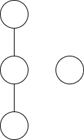

+++
title = "【月刊組合せ論 Natori】彩色対称関数から準対称関数へ　～Shareshian-Wachs 予想～【2026 年 11 月号】"
date = 2026-11-01
tags = ["対称関数"]
+++






月刊組合せ論 Natori は面白そうな組合せ論のトピックを紹介していく企画です。今回は Shareshian-Wachs 予想を解説します。

## OpenAI の衝撃

10 月に OpenAI が大量の数学研究を公開しました。これを受けて、数学者という職業がなくなる、数学という学問が危機に瀕しているなど、様々な議論が巻き起こっています。

そんな中、どのような研究が行われたか気になる人もいるでしょう。さらに深く踏み込んでみたい人もいるかもしれません。

この記事はそんなあなたを応援する記事です。具体的には、OpenAI の発表の中から私が個人的に興味を持っているものを 1 つ選んで解説します。

OpenAI の発表した数学研究は以下の GitHub リポジトリにあります。

https://github.com/openai/math

今回紹介するのは  です。

この研究の概要は次のようになっています。

> Resolves the elementary-positivity part of the Shareshian–Wachs conjecture: the chromatic quasisymmetric function of every natural unit interval graph has elementary-basis coefficients in $\mathbb{N}[q]$. The coefficients count explicitly described permutations, giving a combinatorial explanation of positivity.

要するに Shareshian-Wachs 予想の $e$-positivity 部分を解決したという研究です。ではこの予想はどのような予想なのでしょうか。詳しく見ていきましょう。

## Stanley-Stembridge 予想

Shareshian-Wachs 予想は Stanley-Stembridge 予想と大きく関係します。この予想については以下の記事でも解説していますが、この記事内でも必要な部分を紹介します。

[【月刊組合せ論 Natori】Stanley-Stembridge 予想【2024 年 11 月号】](../202411/)

$G=(V,E)$ をグラフとします。$\mathbb{P}=\{1,2,\ldots\}$ とし、関数 $c\colon V\to\mathbb{P}$ であって各辺 $\{i,j\} \in E$ に対して $c(i)\ne c(j)$ をみたすもの全体からなる集合を $C(G)$ とします。これは頂点 $i$ に $c(i)$ という色を塗ると考えればよいです。$x=(x_1,x_2,\ldots)$ を変数とします。彩色対称関数は

$$
X_G(x)=\sum_{c \in C(G)}\prod_{v\in V}x_{c(v)}
$$

により定義されます。このとき、$X_G(x)$ は対称関数になります。対称関数全体は線形空間となり、この線形空間の基底として基本対称関数 $e_{\lambda}$ があります。ここで $\lambda$ は分割、すなわち広義単調減少な非負整数列です。Stanley-Stembridge 予想は次のような予想です。


$G$ を $(3+1)$-free poset の比較不能性グラフとする。このとき $X_G(x)$ は $e$-positive である。すなわち、$X_G(x)$ を $e_{\lambda}$ の線形結合として表したときの係数は非負整数である。


ここで $(3+1)$-free poset とは以下のような poset を induced subposet として含まない poset であり、poset の比較不能性グラフとは $x\le y$ でも $y\le x$ でもない $x,y$ に辺を張って得られるグラフです。

この予想は疋田氏  によって証明されました。

## 彩色準対称関数

Stanley-Stembridge 予想が未解決だったころ、多くの数学者がこの予想に取り組んでいたと思われます。

予想に取り組むというのは、予想を解くことだけを指しません。予想が他の数学とどのように関係するかを考えたり、予想をさらに発展させたりすることもあります。

Shareshian と Wachs の論文  では、彩色対称関数にさらに情報をもたせて複雑化することで、Stanley-Stembridge 予想をより深く理解しようとしています。

以下、グラフ $G=(V,E)$ の頂点集合は $V=\{1,2,\ldots,n\}$ であるとします。

塗り方 $c \in C(G)$ に対して、$\mathrm{asc}_G(c)$ を隣り合う 2 頂点 $i,j \ (i<j)$ であって $c(i)<c(j)$ をみたすものの個数と定めます。頂点番号が大きい方が色番号も大きくなっているような辺の個数です。そして

$$
\chi_G(x)=\sum_{c \in C(G)}q^{\mathrm{asc}_G(c)}\prod_{v\in V}x_{c(v)}
$$

と定義します。$q=1$ とすると彩色対称関数 $X_G(x)$ となるので、彩色対称関数に情報をもたせたものと考えられます。

実際に計算してみましょう。まずグラフが

１－２

の場合を考えます。頂点 1 に色 $a$、頂点 2 に色 $b$ を塗るとすると

- $a<b$ のとき $\mathrm{asc}_G(\kappa)=1$
- $a>b$ のとき $\mathrm{asc}_G(\kappa)=0$

なので

$$
\chi_G(x)=\sum_{a<b}qx_ax_b+\sum_{a>b}x_ax_b=(q+1)e_2
$$

となります。次は

１－３－２

の場合を考えます。頂点 $1,2,3$ に塗る色をそれぞれ $a,b,c$ とします。$\chi_G(x)$ における $q^2$ の係数を考えます。$a<c$ かつ $b<c$ でなければなりません。次の 3 パターンがあります。

- $a<b$
- $a>b$
- $a=b$

よって

$$
\begin{align*}
[q^2]\chi_G(x)&=\sum_{a<b<c}x_ax_bx_c+\sum_{b<a<c}x_ax_bx_c+\sum_{a<c}x_a^2x_c \\
&=2e_3+\sum_{a<c}x_a^2x_c
\end{align*}
$$

となります。最後に残った和は

$$
x_1^2(x_2+x_3+\cdots)+x_2^2(x_3+x_4+\cdots)+\cdots
$$

のようになり、対称ではありません。$\chi_G(x)$ は対称関数になるとは限りませんが、**準対称関数** (quasisymmetric function) になることが知られています。すなわち、任意の非負整数列 $(e_1,\ldots,e_l)$ および任意の長さ $l$ の添字の増大列 $(i_1,\ldots,i_l), (j_1,\ldots,j_l) \ (i_1<i_2<\cdots<i_l, j_1<j_2<\cdots<j_l)$ に対して、$x_{i_1}^{e_1}\cdots x_{i_l}^{e_l}$ の係数と $x_{j_1}^{e_1}\cdots x_{j_l}^{e_l}$ の係数が等しいです。対称関数ならば準対称関数ですが逆は成り立ちません。

$\chi_G(x)$ を**彩色準対称関数** (chromatic quasisymmetric function) といいます。

## Shareshian-Wachs 予想

お待たせしました。Shareshian-Wachs 予想の主張を述べます。

Stanley-Stembridge 予想はすべてのグラフではなく $(3+1)$-free poset の比較不能性グラフに対する予想でした。同様に Shareshian-Wachs 予想も単位区間グラフと呼ばれる特殊なグラフを対象とします。定義は後述します。


$G$ を単位区間グラフとする。$\chi_G(x)=\sum_{j=0}^m a_j(x)q^j$ とする。このとき $a_j(x)$ はすべての $j$ について $e$-positive であり、$a_{j+1}(x)-a_j(x)$ は $0\le j< (m-1)/2$ に対して $e$-positive である。


特に $G$ が単位区間グラフならば $\chi_G(x)$ は対称関数です。

後半の主張を $e$-unimodal といいます。OpenAI は前半の主張のみを証明しており、$e$-unimodality については証明していません。

また、Shareshian, Wachs の論文では Hessenberg 多様体との関係も予想として述べられていますが、この記事では扱いません。

それでは単位区間グラフを解説します。実数上の単位区間 $[a,a+1]$ からなる有限集合を考えます。2 つの区間の順序関係 $[a,a+1] < [b,b+1]$ を $a+1<b$ により定義します。この順序により $(3+1)$-free poset となります。このような poset の比較不能性グラフを単位区間グラフと呼びます。

実は、単位区間グラフに対して Stanley-Stembridge 予想を証明すれば、元の Stanley-Stembridge 予想も従うことが Guay-Paquet  により示されています。疋田氏の証明も単位区間グラフに対して予想を証明しています。

$q=1$ のとき彩色準対称関数 $\chi_G(x)$ は彩色対称関数 $X_G(x)$ と一致するので $X_G(x)=\sum_{j=0}^m a_j(x)$ となります。よって Shareshian-Wachs 予想から Stanley-Stembridge 予想が従います。

## 証明の概略

 の証明の概略を説明します。全部読んだわけではないので間違っているかもしれません。

まず命題 2.3 と補題 2.5 より、単位区間グラフ $G$ に対して次の式が成り立ちます。

$$
\chi_G(X;v^2)=\sum_{\substack{\lambda \vdash n \\ \ell(\lambda)\le D}}v^M [X_u]m_{\lambda}(Y)e_{\lambda}(X)
$$

これより、$\chi_G(x;q)$ における $e_{\lambda}$ の係数を求める問題は、$m_{\lambda}$ における $X_u$ の係数を求める問題に帰着されます。

そして、定理 5.8 により

$$
m_{\lambda}(Y)=\Theta_{\sum \lambda_id_i}
$$

となります。$\Theta$ はなんかすごいやつです。

そして、定理 4.4 より $\Theta_m$ の係数は非負整数です。

相当雑な概略ですが、こんな感じです。詳しく見ると Hall 代数や scattering diagram なども登場し、難しそうな雰囲気があります。

さらに、単に非負整数であることを示しただけでなく、具体的な表示も得ているようです。

## メッセージ

AI と数学の関係については様々な意見が出ています。中には過激なものもあります。私からは次のような意見を表明しておきたいと思います。

### 数学者の仕事は問題を解くことだけではない

Shareshian, Wachs の論文は Stanley-Stembridge 予想を解いたわけではありませんが、Stanley-Stembridge 予想の理解に大きく役立ちました。

予想に向かって一直線に進むことは、途中にある美しい景色を見逃すことにつながります。寄り道も大事です。（これは数学だけでなく人生でも同じです）

### 数学者の重要性は増していく

OpenAI の研究の中には、重要な結果であると認められたものから、間違っていたため撤回されたものまであります。それを検証するのは数学者の仕事です。

数学者の仕事のうち、問題を解くという作業はかなり AI に代替されそうですが、それは数学者が不要であることを意味しません。問いを立てるといった仕事はまだ人間側に主導権があると思います。

### 数学を楽しんでほしい

自分の頭で考えて理解するという喜びは代替できません。

他者と自分を比較してしまうと楽しむことが難しくなることがあります。強力な AI が登場したことでますます難しくなったと思います。それでも、数学を楽しんでほしいと思います。そのためにも数学を楽しめる環境整備が大切になります。私たちも努力します。

AI が生み出した数学だけでなく、人間が生み出した数学も面白いです。今回の例でいうと Shareshian-Wachs 予想は AI が解きましたが、Stanley-Stembridge 予想は人間が解きました。今回をきっかけにいろいろ調べてみましょう。私は初学者を応援します。

## おわりに

私は AI 企業が数学のあり方を（よくないと思っている方向へ）大きく変えてしまったのを見て心を痛めていました。数学が好きという気持ちにも自信が持てなくなってしまいました。

ですが、数学は大昔から続く人類の大切な営みです。そう簡単に終わらせてはいけません。これからも、大切なところは守り、使えるものは使っていくことで、数学を楽しんでいきたいと決心しました。

これからも数学のことを発信していくので、みなさんと一緒に数学を楽しんでいきたいです。

## 宣伝

[組合せ論 Advent Calendar 2026](https://adventar.org/calendars/12703) が始まります。みなさんの組合せ論に関する記事を読めることを楽しみにしています。ぜひご参加ください！

## 参考文献

